# OpenSHM

Personal interoperability between a Galaxy Watch and a **non-Samsung** Android phone. With it, the
Samsung Health Monitor (SHM) app can measure ECG, blood pressure and irregular heart rhythm
notifications (IHRN) on the watch and sync them with the phone. It also includes our own bridge for
alarms, notifications and calls.

This repository **contains no vendor code and no APKs**. It holds:

- the patches, written as patterns anchored to the official APKs;
- our own code;
- the tools that rebuild everything from the official APKs, which each user obtains on their own.

The resulting APKs are signed with the user's own key. They are for personal use and are not
redistributed.

**Unlike Dante's version, this compatibility layer DOES work on modern One UI Watch releases. It is
verified on One UI 8 Watch (Wear OS 6, Android 16 / API 36).** Older One UI Watch releases have not
been tested.

| Tested setup | Version |
|---|---|
| Watch | Galaxy Watch5 Pro (SM-R920), One UI 8 Watch, firmware `R920XXS2DZG3` (security patch 2026-08-05) |
| Health Platform on the watch | 1.7.00.05 |
| Samsung Health Monitor | 1.5.1.022 (watch), 1.4.6.001 (phone) |
| Phone | Motorola razr fold (non-Samsung) |

## Getting started: the patcher app

The easiest way is **OpenSHM Patcher** (`patcher-app/`). This Android app does the whole job on the
phone itself; no PC is needed. Download the latest APK from the
[Releases](https://github.com/LibreStatic/OpenSHM/releases) page and install it on the phone.

The app guides you through these steps:

1. **Pairing**: the stock Galaxy Wearable pairing, then a Wireless debugging (ADB) pairing with the
   watch.
2. **Inputs**: getting the official APKs (from APKMirror, a file, or pulled from your own watch or
   phone). Each one is checked against the hashes in the catalogue.
3. **Build**: patching, signing and verifying five APKs with a key that is created on, and stays on,
   your phone:
   - SHM for the phone and for the watch;
   - the phone and watch bridges;
   - the Alarm app fork.
4. **Install on the phone**: installing the apps and granting their permissions.
5. **Install on the watch**: installing the apps over Wi-Fi, granting their permissions, turning on
   Health Platform developer mode, and turning off the stock watch SHM. Nothing is uninstalled.
6. **Self-test**: automatic checks, followed by a few questions about what you see on the devices.

The patches come from a **signed catalogue** (`catalogue/`), and the app can update it from this
repository. The catalogue is data only: the app checks its ECDSA signature and never runs code from
it.

Export the signing key from the app after the first build. Upgrading the installed apps without
losing data requires the **same key and the same package prefix**.

## Walkthrough

This section shows the patcher step by step, from the first screen to the end. The screenshots come
from an emulator with **made-up data**: the addresses, versions, sizes and package prefix are
examples, so your screens will show your own values.

### 1. Welcome

Open OpenSHM Patcher. **What will change on my devices?** lists every app that will be installed on
the phone and on the watch, and what each one is allowed to do. Tap **Get started**.

<p>
  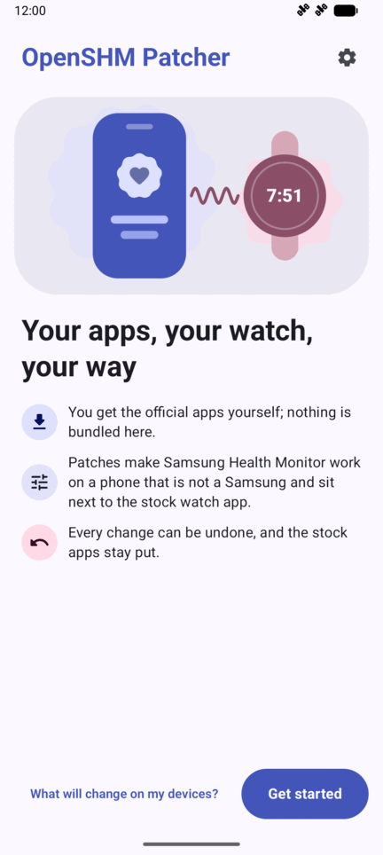
  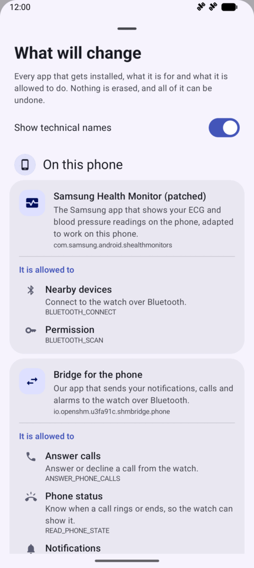
</p>

### 2. Pick your watch

Choose the Wear OS version of your watch. If the watch is already reachable, the patcher checks the
version for you. This decides which official apps you need: Health Monitor, plus the Alarm app on
Wear OS 5 or newer.

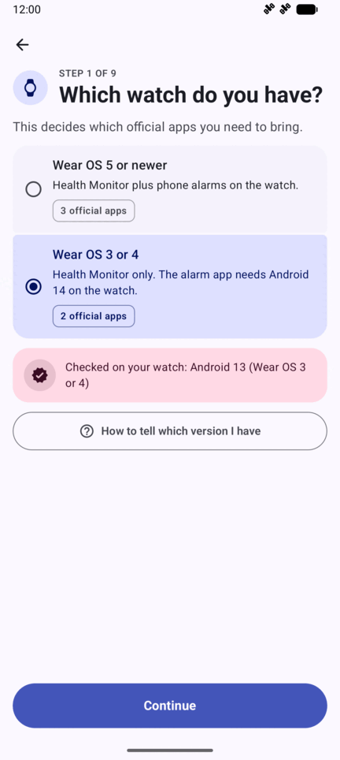

### 3. Pair the watch with Galaxy Wearable

Pair the watch the usual way, with Galaxy Wearable and the watch plugin from the Play Store. All
three checks must be ticked before you continue. If pairing fails, **Trouble pairing?** has the
known fixes.

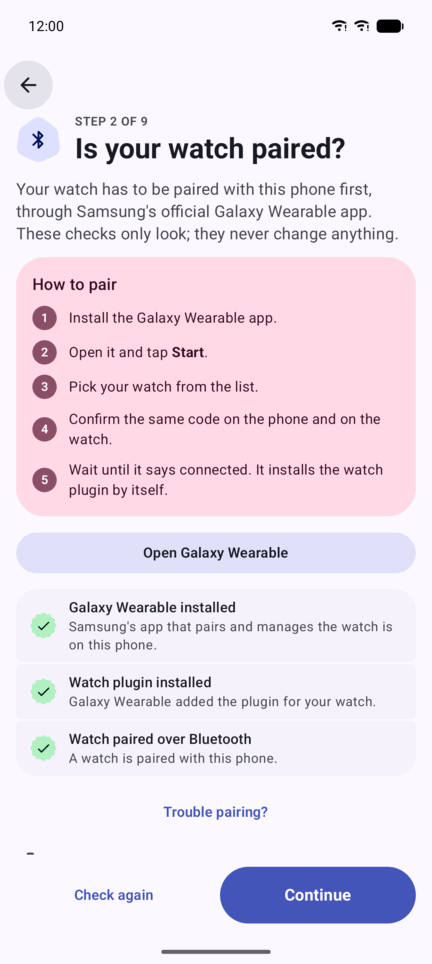

### 4. Connect to the watch over Wi-Fi

The patcher installs apps on the watch over Wireless debugging. Put the phone and the watch on the
same Wi-Fi network, then follow the guide on screen:

1. On the watch, open **Settings → About watch → Software information**.
2. Tap **Software version** until developer mode turns on.
3. In **Developer options**, turn on **Wireless debugging**, allow it, then choose **Pair new
   device**.

The patcher finds the watch on the network by itself. Type the 6-digit code shown on the watch and
tap **Pair**.

<p>
  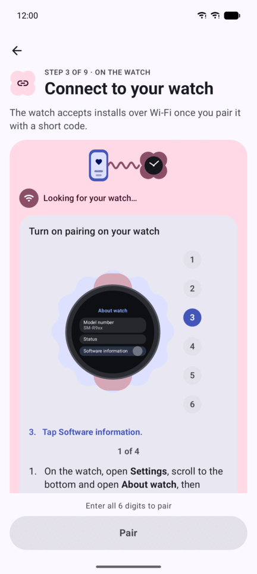
  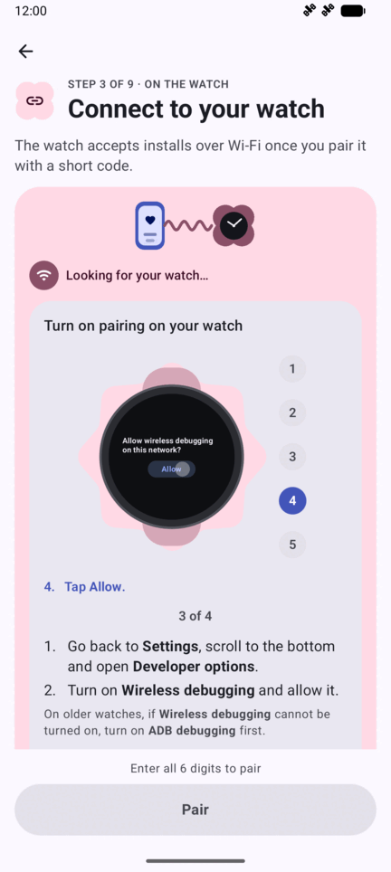
  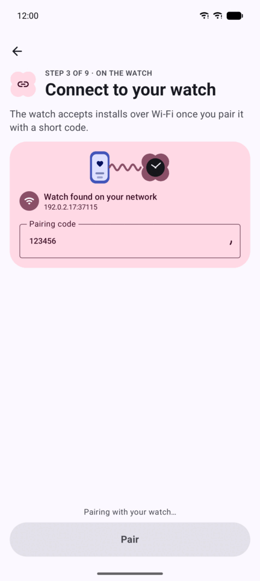
</p>

### 5. Bring the official apps

You get the official Samsung APKs yourself; the patcher never ships them. For each app, either:

- tap **Open on APKMirror**, and a guided browser shows which variant to pick (APK, not bundle,
  `nodpi`) and catches the download;
- or, from the menu next to that button, pick a file you already have, or pull the app from your
  own watch or phone.

Every file is checked against the catalogue's checksum. Continue unlocks once all of them match.

<p>
  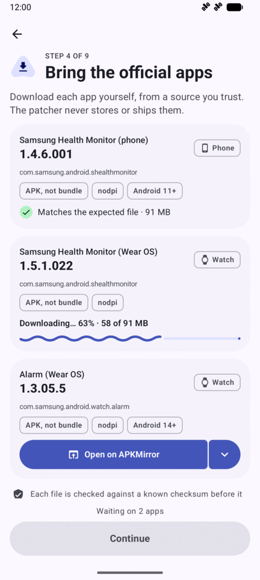
  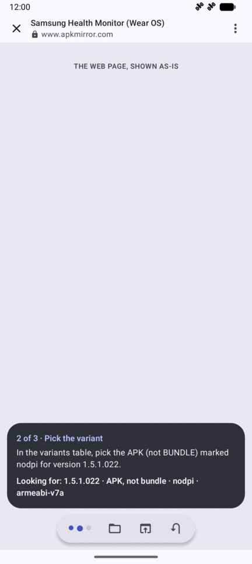
</p>

### 6. Review the patches and build

The required patches are locked; the others can be switched off. The defaults are recommended. Tap
**Build**. The build runs in the background with a notification, so you can leave the app. When it
finishes, all five apps are patched and signed with your own key. The app then offers to back up
that key: **do it**, because you will need it for future updates.

<p>
  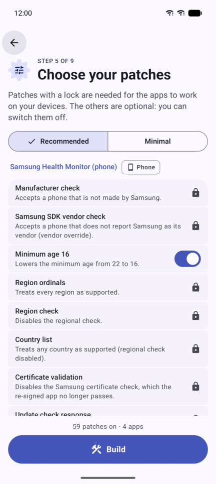
  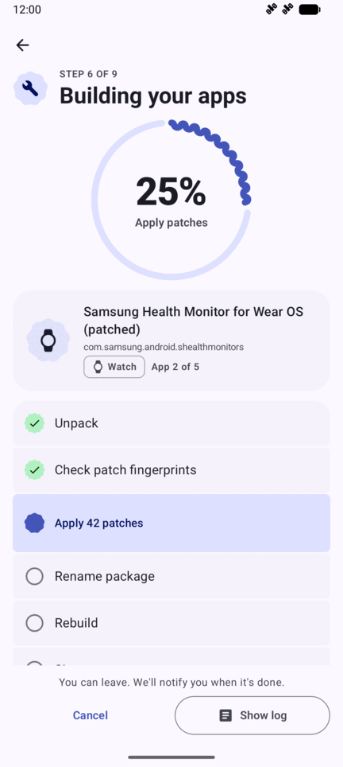
  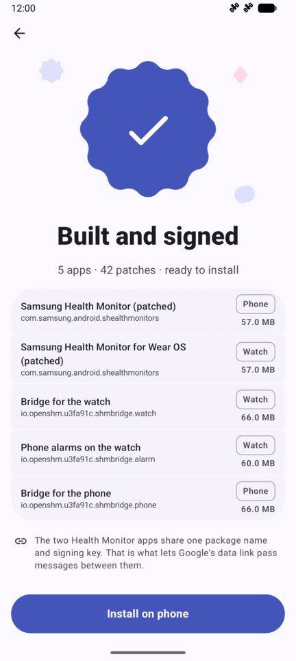
</p>

### 7. Install on the phone

Tap **Start installing** and confirm each Android install prompt. The patcher then checks the
permissions each app needs. Any missing one has an **Open settings** button, where you switch it on
yourself.

Open the patched Samsung Health Monitor once and finish its setup.

<p>
  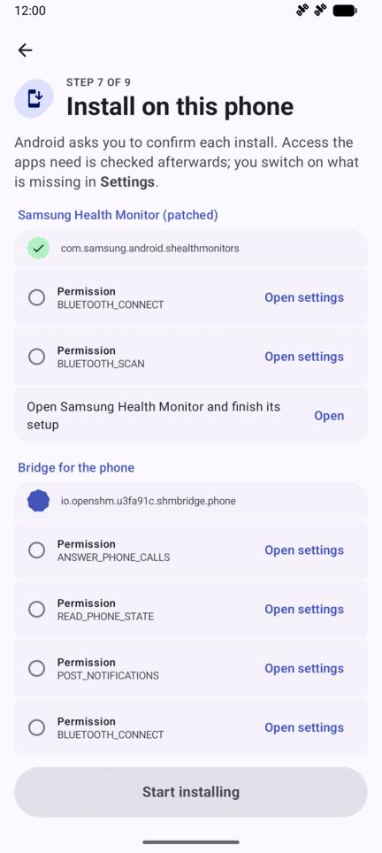
  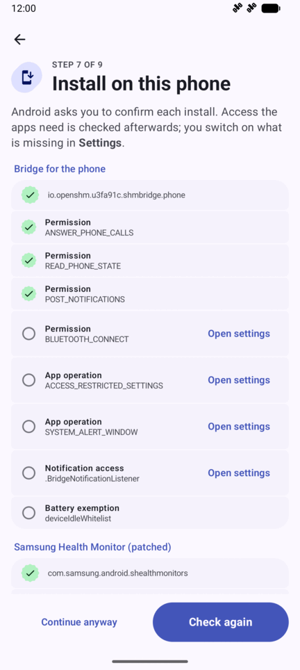
</p>

#### The easy way: let the patcher grant everything (Wireless debugging on this phone)

Some permissions are hard to find in Settings, and on Android 13 or newer some of them are blocked
as *restricted settings*. The patcher can switch them all on for you. To do that, it connects to
**this same phone** through Wireless debugging, a built-in Android developer feature.

This sounds technical, but it is a one-time setup of a few taps. Read the whole list once before
you start, because you will move between the patcher, Settings and the notification panel.

> You need Wi-Fi for this: any network works, even without internet. Mobile data is not enough.
> Nothing here changes your data, and you can turn Wireless debugging and Developer options off
> again when you are done.

**Step A: tap the button in the patcher.** Scroll down to **Grant everything at once** and tap
**Grant everything with Wireless debugging**. The card shows the steps that follow. The patcher
keeps waiting in the background and opens Developer options for you. If they are not on yet, do
step B first.

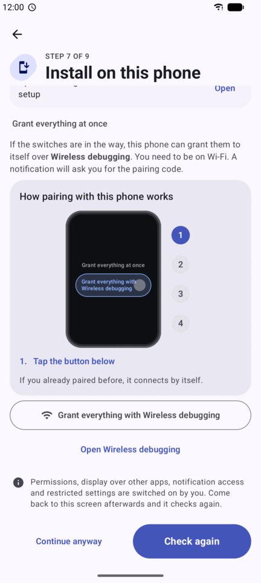

**Step B: turn on Developer options** (only the first time).

1. Open **Settings → About phone**. On some phones it is under *Settings → System → About phone*.
2. Scroll to the bottom and tap **Build number** seven times in a row. On some phones it is inside
   *Software information*.
3. After a few taps Android counts down (*"You are now 1 step away from being a developer"*).
   If you have a screen lock, it asks for your PIN at the end. Then it says *"You are now a
   developer!"*.

<p>
  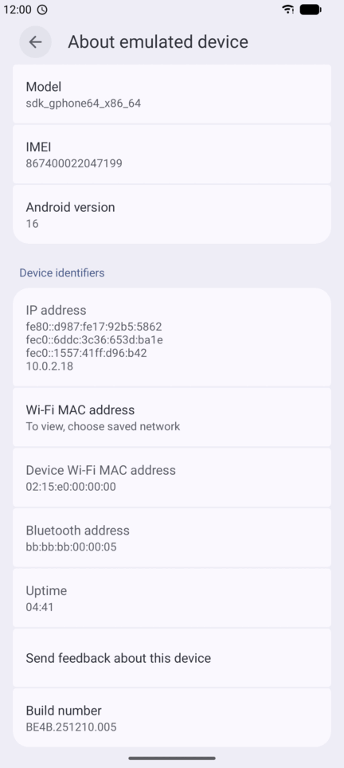
  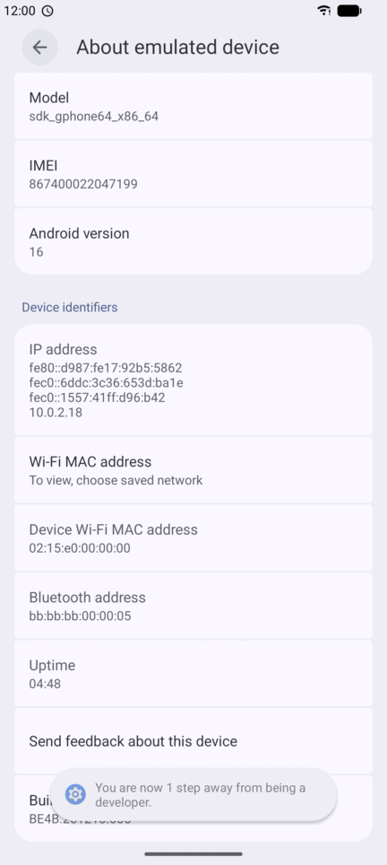
</p>

**Step C: turn on Wireless debugging.**

1. Go to **Settings → System → Developer options**. The patcher normally opens it for you, scrolled
   to the right place.
2. Find **Wireless debugging** in the *Debugging* section and tap its **name**, not only the
   switch, to open its page.
3. Turn on **Use wireless debugging**. Android asks *"Allow wireless debugging on this network?"*:
   tap **Allow**.

<p>
  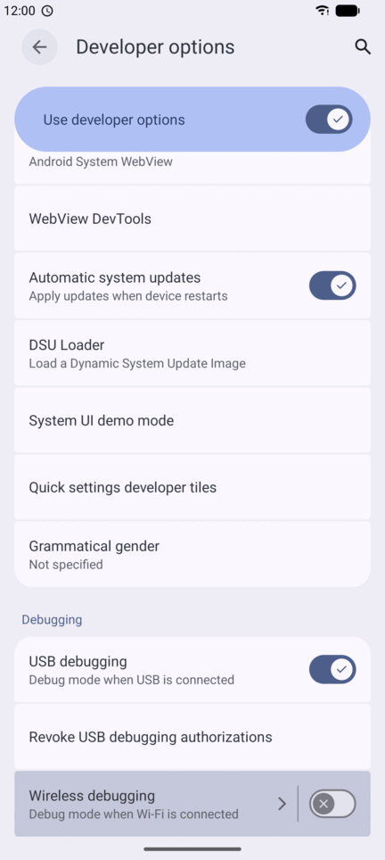
  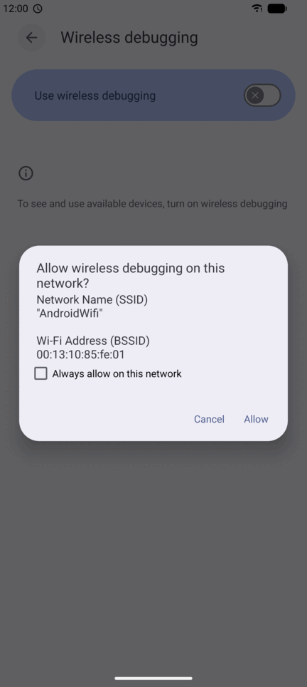
</p>

**Step D: get a pairing code.** On the Wireless debugging page, tap **Pair device with pairing
code**. Android shows a six-digit **Wi-Fi pairing code**. Leave this window open: closing it cancels
the code.

<p>
  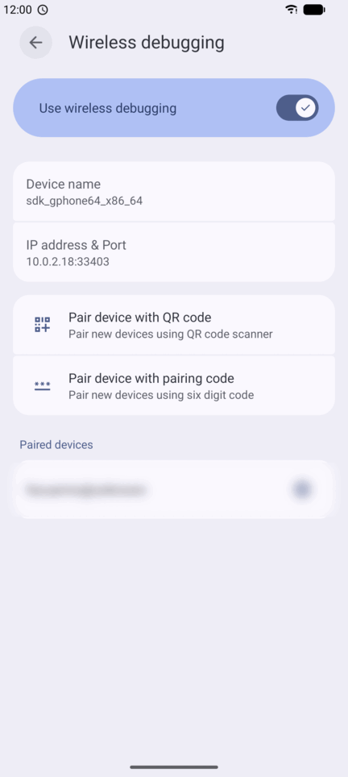
  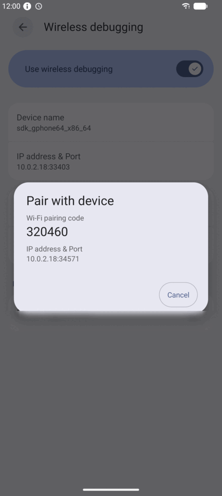
</p>

**Step E: give the code to the patcher.** Without closing the code window:

1. Swipe down from the top of the screen to open the notification panel.
2. Find the OpenSHM Patcher notification **Enter the pairing code** and tap **Enter code**.
3. Type the six digits shown on the code window and tap the send arrow.

You can also go back to the patcher and type the code there, but the notification is easier,
because it keeps the code window on screen.

<p>
  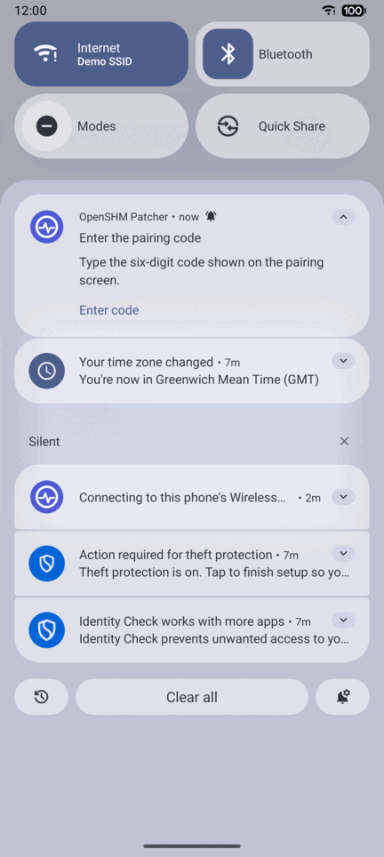
  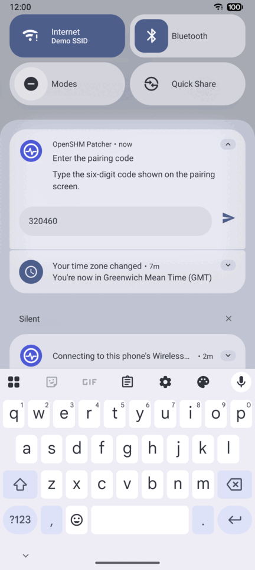
</p>

**Step F: done.** The code window closes by itself. The patcher connects and switches on every
missing permission. Go back to the patcher: it shows **All set** and the permission list turns
green. *OpenSHM* now appears under **Paired devices** in Wireless debugging. The pairing is
remembered, so next time the patcher reconnects without a new code, as long as Wireless debugging is
on.

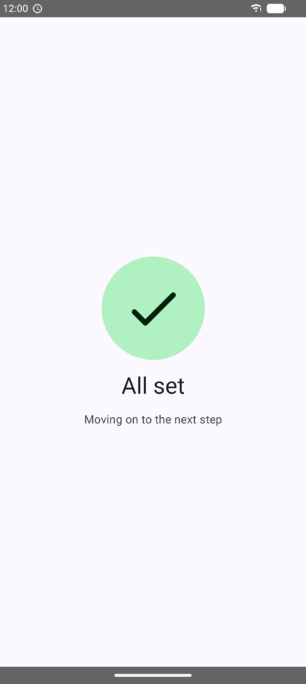

**If something goes wrong:**

- *The notification never asks for a code*: check that Wireless debugging is on and that the phone
  is on Wi-Fi. Also check that notifications are allowed for OpenSHM Patcher.
- *"Wrong code"*: codes expire when the window closes. Tap **Pair device with pairing code**
  again and use the new code.
- *Wireless debugging turns itself off*: Android turns it off when you change Wi-Fi networks. Turn
  it on again; you will not need a new code.

### 8. Install on the watch

The watch apps are installed over Wi-Fi, in order: Health Monitor, the bridge, then phone alarms.
Their permissions are granted automatically. Then:

- **Health Platform developer mode**: tap **Turn it on for me** and keep the watch unlocked and
  nearby; or do it by hand, as shown on screen. Without it, the watch will not take ECG
  measurements with the patched app.
- **Turn off the stock app**: the stock Health Monitor is disabled, not uninstalled, so it does not
  compete with the patched one for the sensor. Apps that are already off are marked as done.

<p>
  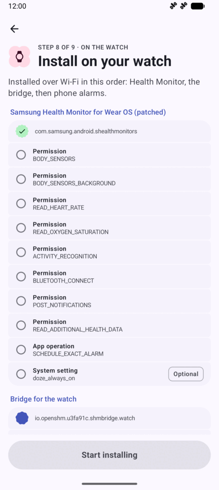
  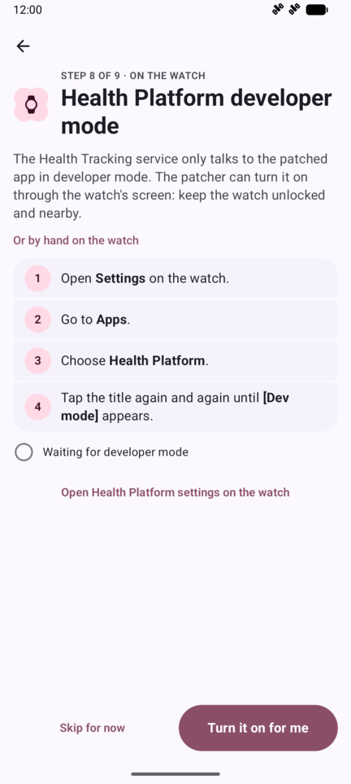
  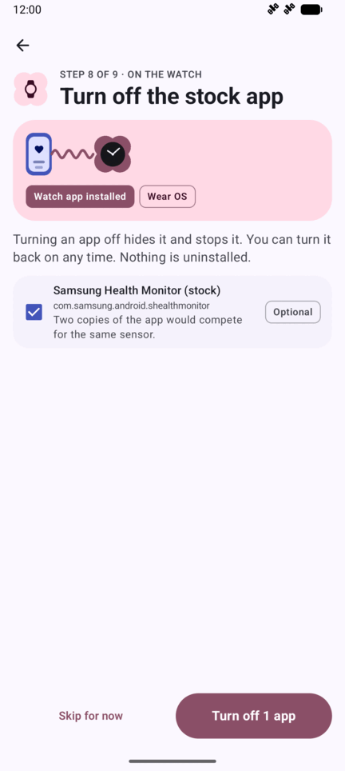
</p>

### 9. Self-test

The patcher runs these checks:

- it confirms what is installed on both devices, with which signature;
- it confirms that permissions are granted;
- it checks that the bridge link between the phone and the watch is up.

It then asks you a few questions about what you see on the devices. When every check passes, you
are done. **Share report** produces a report with versions and results only, which is useful if
something fails.

<p>
  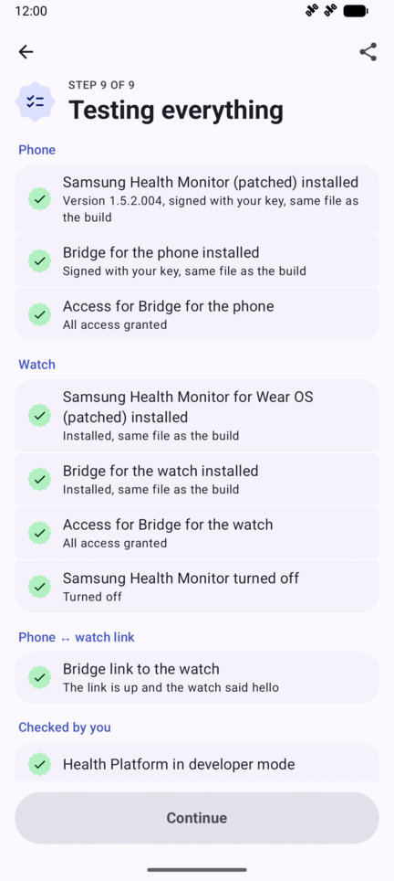
  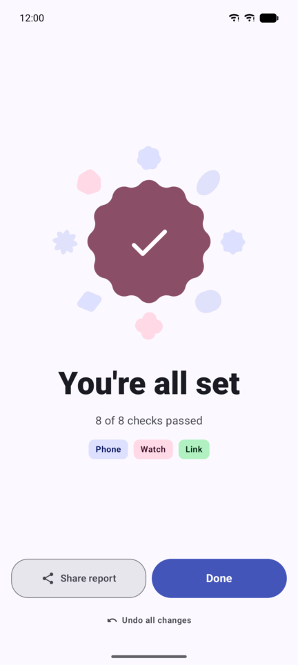
</p>

### 10. Home

From then on, the app opens on **Home**. It shows:

- the state of the last test, with **Test again**;
- the apps you built;
- an update card when a newer catalogue supports newer official apps.

Each app can be rebuilt or restored, which turns the stock apps back on and removes ours.

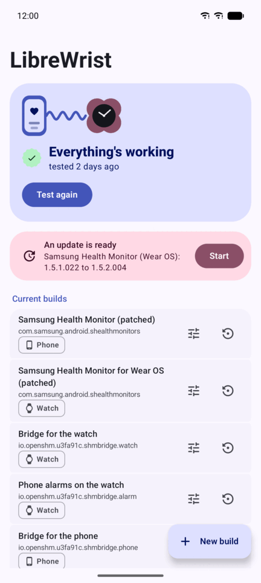

### What to expect when you are done

- **On the watch**, the patched Samsung Health Monitor replaces the stock one in the app list. It
  offers ECG, and blood pressure once calibrated. Irregular heart rhythm notifications can be turned
  on from the phone app.
- **On the phone**, Samsung Health Monitor finds the watch as a compatible device. Readings taken
  on the watch appear there and can be exported as PDF.
- **The bridge** sends phone notifications, incoming calls (answer or decline from the watch) and
  phone alarms to the watch over Bluetooth, with no Samsung phone involved.
- Nothing stock was uninstalled. Galaxy Wearable keeps managing the watch as before.

### How to check that it works

1. **ECG**:
   - On the watch, open Samsung Health Monitor, choose **ECG**, rest your arm on a table and hold a
     fingertip on the top button for 30 seconds.
   - The watch shows a result (for example *Sinus rhythm*). Within a minute, the same reading shows
     up in Samsung Health Monitor on the phone.
2. **Blood pressure**:
   - In the phone app, start a calibration with a cuff monitor, taking three readings.
   - After that, measure from the watch. The result syncs to the phone the same way as ECG.
3. **Bridge**:
   - Send yourself a message, or call the phone: the notification or the call shows on the watch.
   - Set an alarm on the phone a couple of minutes ahead: it rings on the watch.
4. **If something does not arrive**, run **Test again** from Home and share the report. Most
   problems are one of these:
   - Health Platform developer mode turned off on the watch;
   - a missing permission;
   - the watch disconnected from Galaxy Wearable.

## How it works

1. The watch is paired with the phone through the stock Galaxy Wearable flow, which creates the GMS
   Data Layer between them.
2. Both patched SHM apps share one package (`com.samsung.android.shealthmonitors`) and one signing
   certificate. GMS needs both to deliver messages between the two apps.
3. On the watch, our ECG adapter talks to the Health Tracking service through a clean-room client
   ([protocol](docs/health-tracking-protocol.md)). The service only accepts it while Health
   Platform developer mode is on.
4. The bridge talks to the watch directly over RFCOMM, phone ⇄ watch.

Everything runs on the two devices. Details are in [docs/architecture.md](docs/architecture.md).

## Repository layout

| Path | What it is |
|---|---|
| `patcher-app/` | The OpenSHM Patcher Android app, a Gradle build with three modules: `:engine` (pure JVM patch engine), `:adb` (ADB client) and `:app` (Compose UI). Third-party licences are in [patcher-app/THIRD_PARTY.md](patcher-app/THIRD_PARTY.md). |
| `catalogue/` | The signed patch catalogue. `catalogue.json` describes the inputs, profiles and patterns as data; `catalogue.json.sig` and `catalogue.pub` are its signature and public key. Details in [docs/patches.md](docs/patches.md). |
| `superpatcher/`, `scripts/superpatcher.py` | The Python patch engine. It interprets the same catalogue as the app. |
| `watch-mod/` | Our own code injected into the watch SHM: the ECG adapter, the Health Tracking client and the vendor overrides. |
| `shm-bridge/` | Our own bridge apps (phone ⇄ watch over direct RFCOMM) and the fork of the watch Alarm app. |
| `scripts/` | The PC build (`build_all.sh`, `build_shm_*.sh`, `fetch_deps.sh`), catalogue tooling (`catalogue.py`), and shared helpers in `scripts/lib/`. |
| `apks/` | Where the official input APKs go for PC builds. They are not versioned; see [apks/README.md](apks/README.md) and `apks/inputs.json`. |
| `docs/` | [Architecture](docs/architecture.md), [installation runbook](docs/installation.md), [patches](docs/patches.md), [Health Tracking client](docs/health-sdk.md) and [protocol](docs/health-tracking-protocol.md). |

## Building on a PC

The original shell pipeline is still available, and it produces the same five APKs:

```bash
scripts/fetch_deps.sh                 # apktool into third_party/
# copy the official APKs into apks/ with the names listed in apks/SHA256SUMS
PKG_PREFIX=com.example scripts/build_all.sh
```

All configuration lives in [`config.env`](config.env) and can be overridden through environment
variables: package prefix, SDK, keystore and directories. Our source code uses the package
placeholder `shminterop`, and builds rewrite it to the chosen `PKG_PREFIX`. Manual installation with
ADB, pairing, and known gotchas are covered in [docs/installation.md](docs/installation.md).

### Building the patcher app

The launcher `patcher-app/gradlew` is a jar-free script, since the repository carries no jars. Run
it with a JDK 17 and the Android SDK:

```bash
JAVA_HOME=/path/to/jdk17 patcher-app/gradlew :engine:test :app:testDebugUnitTest :app:assembleDebug
```

Builds are signed with `patcher.p12` and `patcher.pass` from `OPENSHM_KEYS_DIR` (key alias
`PATCHER_KEY_ALIAS`, default `patcher`). Without them, builds fall back to the SDK debug key. The
published releases are built by `.github/workflows/patcher-release.yml` and signed with the
LibreStatic release key.

## Tests

```bash
python3 -m unittest discover -s superpatcher -p 'test_*.py'
python3 -m unittest discover -s scripts -p 'test_*.py'
shm-bridge/watch/test/run-tests.sh
watch-mod/test/run-tests.sh
JAVA_HOME=/path/to/jdk17 patcher-app/gradlew :engine:test :app:testDebugUnitTest
```

## Scope

Dropped on purpose:

- the PC relay or gateway, replaced by native GMS and direct RFCOMM;
- the Galaxy Wearable proxy, which never worked.

Never needed:

- a factory reset;
- a Samsung phone.

## Licence

Our own code is released under the [MIT Licence](LICENSE). The MIT licence does not cover:

- Samsung's apps and the APKs built from them, which remain under their owners' terms;
- the third-party libraries shipped in the patcher app, which keep their own licences (see
  [patcher-app/THIRD_PARTY.md](patcher-app/THIRD_PARTY.md)).

This is an independent project. It is not affiliated with Samsung or Google.
