# LibreWrist

> LibreWrist was formerly called OpenSHM (some identifiers, such as the `io.openshm` package, keep that name).

Personal interoperability between a Galaxy Watch and a **non-Samsung** Android phone. With it, the
Samsung Health Monitor (SHM) app can measure ECG, blood pressure, irregular heart rhythm
notifications (IHRN) and sleep apnea on the watch and sync them with the phone. It also includes our own bridge for
alarms, notifications and calls.

This repository **contains no vendor code and no APKs**. It holds:

- the patches, written as patterns anchored to the official APKs;
- our own code;
- the tools that rebuild everything from the official APKs, which each user obtains on their own.

The resulting APKs are signed with the user's own key. They are for personal use and are not
redistributed.

> [!CAUTION]
> **LibreWrist is a proof of concept, and its health readings are not validated.** The watch does
> not let the modified Samsung apps use Samsung's own sensor channels, so LibreWrist feeds them with
> its own code, and results can differ from an unmodified Samsung setup. There is no clinical
> validation. So far only the ECG has been compared against the unmodified apps: on a Galaxy
> Watch5 Pro paired to a Galaxy S24 Ultra, both gave the same classification and heart rate
> ([details](docs/ecg-calibration.md), section 5b); blood pressure and SpO2 have not been compared
> yet. Do not use it for medical decisions. The software is provided "as is", without warranty
> (see the [licence](LICENSE)).

> [!WARNING]
> **Built through reverse engineering, so some details may have been inferred incorrectly.** The
> patches, the [Health Tracking protocol](docs/health-tracking-protocol.md) and the sensor
> adapters' formats and calibration ([ECG](docs/ecg-calibration.md), [BP](docs/bp-calibration.md),
> [SpO2](docs/spo2-calibration.md), [IHRN](docs/ihrn-adapter.md)) were worked out from the official
> apps and firmware, not from vendor documentation. The adapters do their own filtering, contact
> detection, quality checks and SpO2 estimation, so a wrong assumption can change the results.
> If something looks off, please [open an issue](https://github.com/LibreStatic/LibreWrist/issues).

> [!NOTE]
> **LibreWrist is not Dante's SHM MOD.** SHM MOD keeps Samsung's own sensors and adapters as they
> are; LibreWrist replaces them with its own, so their algorithms and results differ. LibreWrist is
> verified on **One UI 8 Watch (Wear OS 6, Android 16 / API 36)**; older releases are untested.

| Tested setup | Version |
|---|---|
| Watch | Galaxy Watch5 Pro (SM-R920), One UI 8 Watch, firmware `R920XXS2DZG3` (security patch 2026-08-05) |
| Health Platform on the watch | 1.7.00.05 |
| Samsung Health Monitor | 1.5.2.009 (watch), 1.5.3.011 (phone) |
| Samsung Health (built as Samsung Health+, optional) | 7.2.0.041 (phone) |
| Phone | Motorola razr fold (non-Samsung) |

The patcher recognizes the watch plugin of every Galaxy Watch family, and includes a fix for the
watch SHM closing on open on the Galaxy Watch8. The patcher UI is available in English and 18 other languages, and
the bridge texts into the same 88 locales as the call notice.

## Contents

- [Quick start video](#quick-start-video)
- [Getting started: the patcher app](#getting-started-the-patcher-app)
- [Walkthrough](#walkthrough)
  - [1. Welcome](#1-welcome)
  - [2. Pick your watch](#2-pick-your-watch)
  - [3. Pair the watch with Galaxy Wearable](#3-pair-the-watch-with-galaxy-wearable)
  - [4. Connect to the watch over Wi-Fi](#4-connect-to-the-watch-over-wi-fi)
  - [5. Bring the official apps](#5-bring-the-official-apps)
  - [6. Review the patches and build](#6-review-the-patches-and-build)
  - [7. Install on the phone](#7-install-on-the-phone)
  - [8. Install on the watch](#8-install-on-the-watch)
  - [9. Self-test](#9-self-test)
  - [10. Home](#10-home)
  - [Optional apps](#optional-apps)
  - [What to expect when you are done](#what-to-expect-when-you-are-done)
  - [How to check that it works](#how-to-check-that-it-works)
- [Known issues](#known-issues)
- [How it works](#how-it-works)
- [Repository layout](#repository-layout)
- [Building on a PC](#building-on-a-pc)
  - [Building the patcher app](#building-the-patcher-app)
- [Tests](#tests)
- [Scope](#scope)
- [Licence](#licence)

## Quick start video

Prefer watching to reading? This 90-second video shows the whole setup, step by step. The screens
use sample data. Click it to open the full-quality MP4.

[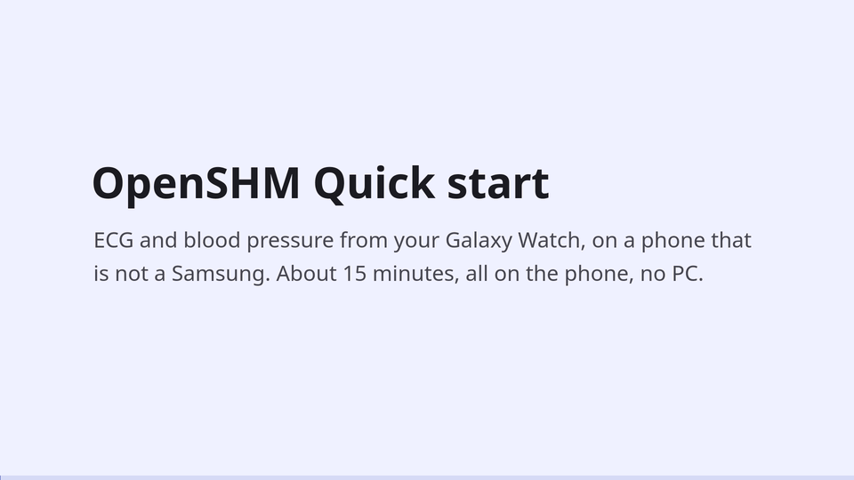](docs/media/quick-start.mp4)

[↑ Back to contents](#contents)

## Getting started: the patcher app

The easiest way is **LibreWrist** (`patcher-app/`). This Android app does the whole job on the
phone itself; no PC is needed. Download the latest APK from the
[Releases](https://github.com/LibreStatic/LibreWrist/releases) page and install it on the phone.

The app guides you through these steps:

1. **Pairing**: the stock Galaxy Wearable pairing, then a Wireless debugging (ADB) pairing with the
   watch.
2. **Inputs**: getting the official APKs (from APKMirror, a file, or pulled from your own watch or
   phone). Each one is checked against the hashes in the catalogue.
3. **Build**: patching, signing and verifying up to six APKs (Health Monitor and Samsung Health+ are optional) with a key that is created on, and stays on,
   your phone:
   - SHM for the phone and for the watch;
   - the phone and watch bridges;
   - the Alarm app fork;
   - **Samsung Health+**, optional and on by default (see below).
4. **Install on the phone**: installing the apps and granting their permissions.
5. **Install on the watch**: installing the apps over Wi-Fi, granting their permissions, turning on
   Health Platform developer mode, and turning off the stock watch SHM. Nothing is uninstalled.
6. **Self-test**: automatic checks, followed by a few questions about what you see on the devices.

The patches come from a **signed catalogue** (`catalogue/`), and the app can update it from this
repository. The catalogue is data only: the app checks its ECDSA signature and never runs code from
it.

Export the signing key from the app after the first build (the export and import forms open as
dialogs; the app also offers an automatic backup right after the first build). The app also keeps a
copy in your Google account (Google Play services Block Store, end-to-end encrypted when the phone
has a screen lock) and restores it by itself when the phone has no key, for example after a
reinstall. Upgrading the installed apps without losing data requires the **same key and the same
package prefix**.

[↑ Back to contents](#contents)

## Walkthrough

This section shows the patcher step by step, from the first screen to the end. The screenshots come
from an emulator with **made-up data**: the addresses, versions, sizes and package prefix are
examples, so your screens will show your own values.

### 1. Welcome

Open LibreWrist. **What will change on my devices?** lists every app that will be installed on
the phone and on the watch, and what each one is allowed to do. Tap **Get started**.

<p>
  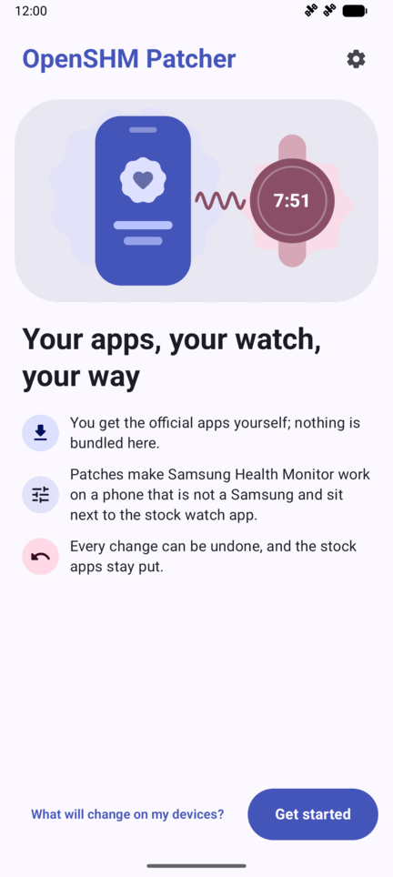
  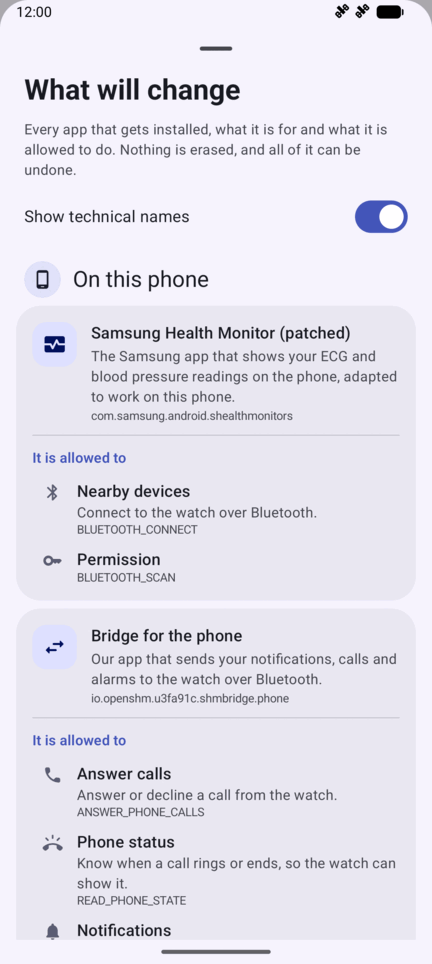
</p>

### 2. Pick your watch

Choose the Wear OS version of your watch. If the watch is already reachable, the patcher checks the
version for you. This decides which official apps you need: Health Monitor, plus the Alarm app on
Wear OS 5 or newer.

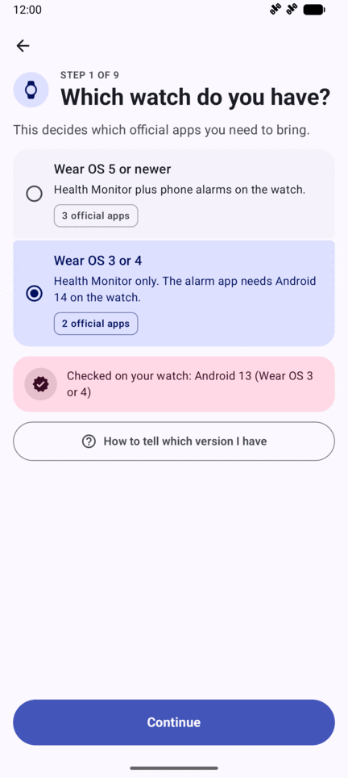

### 3. Pair the watch with Galaxy Wearable

Pair the watch the usual way, with Galaxy Wearable and the watch plugin from the Play Store. All
three checks must be ticked before you continue. If pairing fails, **Trouble pairing?** has the
known fixes.

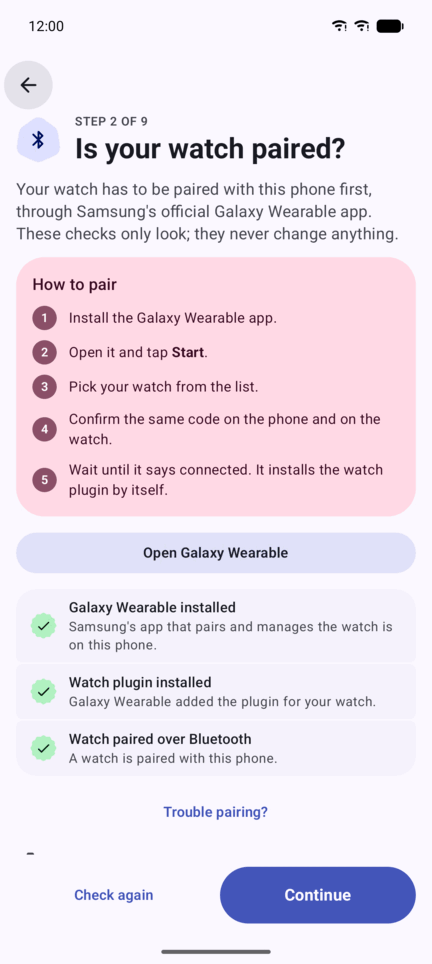

### 4. Connect to the watch over Wi-Fi

The patcher installs apps on the watch over Wireless debugging. Put the phone and the watch on the
same Wi-Fi network, then follow the guide on screen:

1. On the watch, open **Settings → About watch → Software information**.
2. Tap **Software version** until developer mode turns on.
3. In **Developer options**, turn on **Wireless debugging**, allow it, then choose **Pair new
   device**.

The patcher finds the watch on the network by itself. Type the 6-digit code shown on the watch and
tap **Pair**.

<p>
  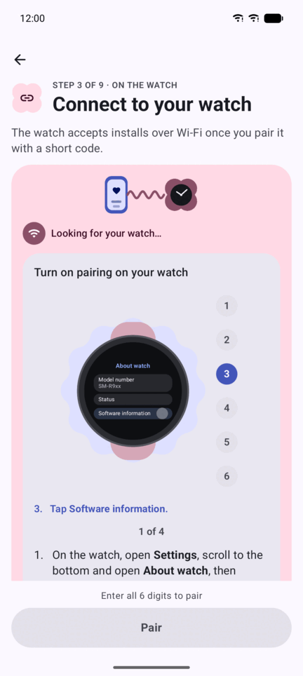
  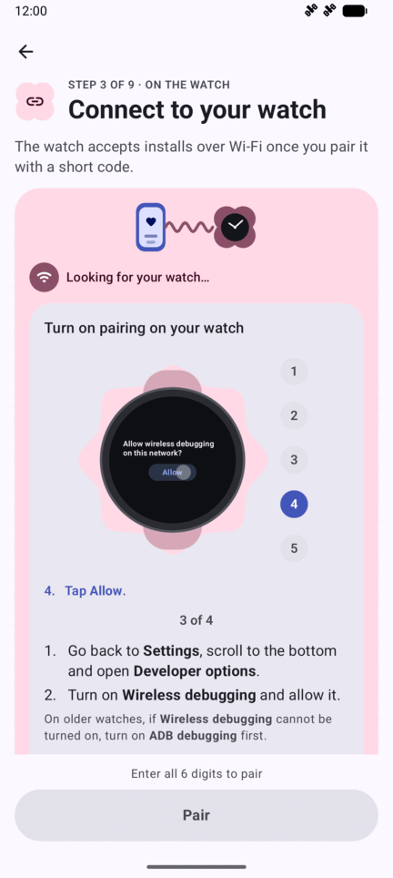
  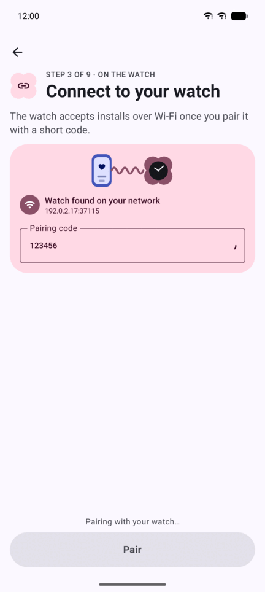
</p>

### 5. Bring the official apps

You get the official Samsung APKs yourself; the patcher never ships them. For each app, either:

- tap **Open on APKMirror**, and a guided browser shows which variant to pick (APK, not bundle,
  `nodpi`) and catches the download;
- or, from the menu next to that button, pick a file you already have, or pull the app from your
  own watch or phone.

Every file is checked against the catalogue's checksum. Continue unlocks once all of them match.

<p>
  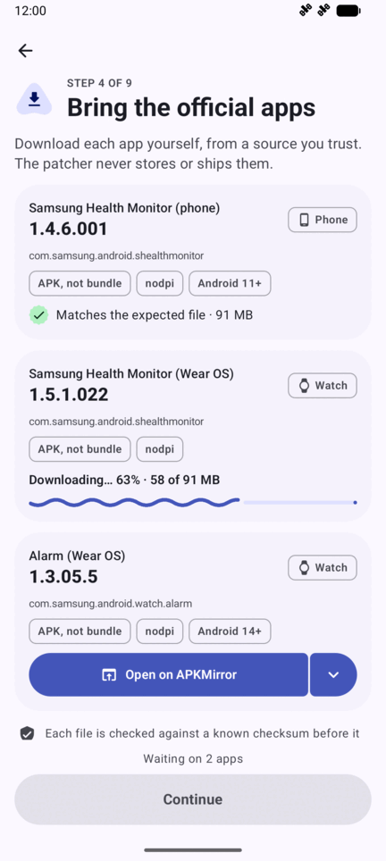
  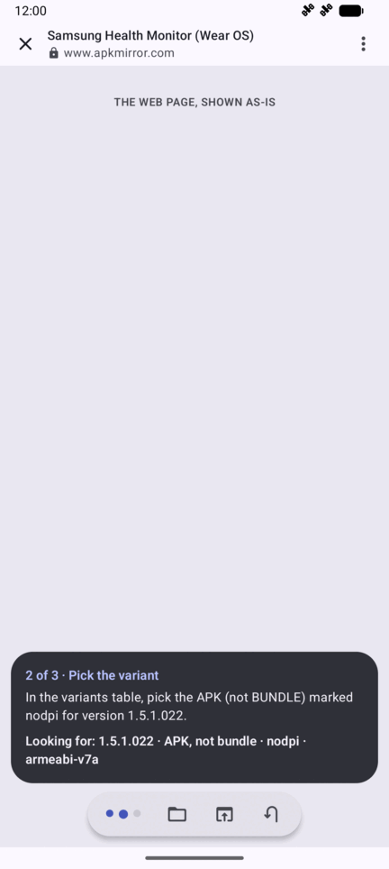
</p>

### 6. Review the patches and build

The required patches are locked; the others can be switched off. The defaults are recommended. Tap
**Build**. The build runs in the background with a notification, so you can leave the app. When it
finishes, every selected app is patched and signed with your own key. The app then offers to back
up that key: **do it**, because you will need it for future updates. A copy also goes to your Google
account when Google Play services is available.

Later builds only patch again the apps whose inputs or patches changed. The others are reused, and
**Built and signed** marks them as *Unchanged*.

<p>
  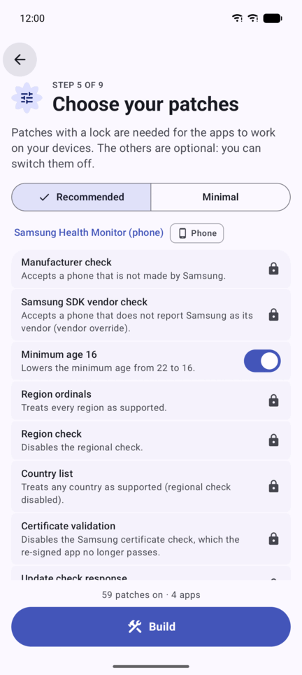
  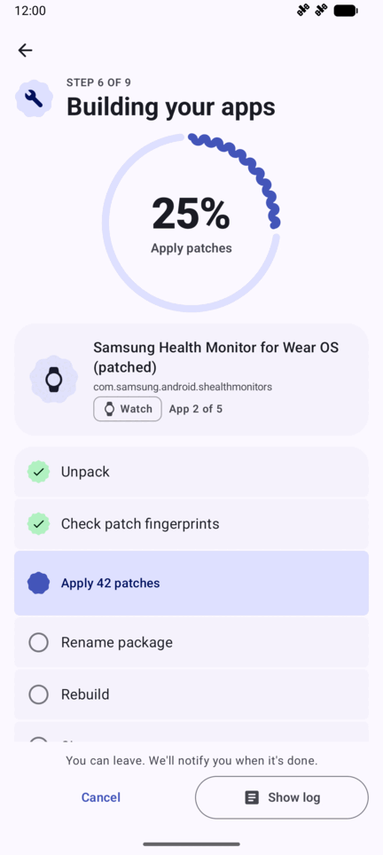
  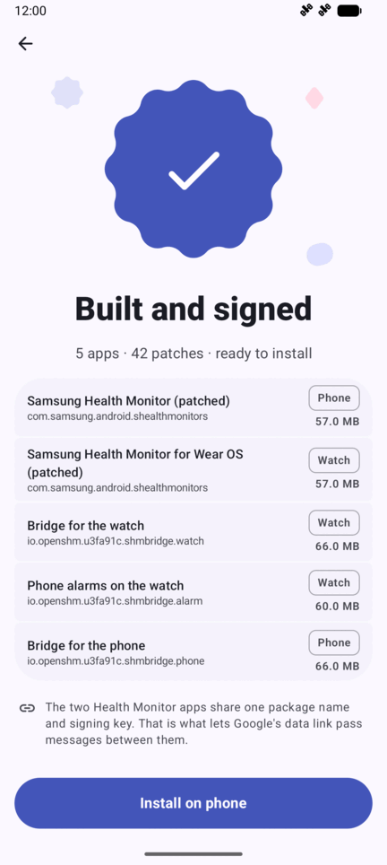
</p>

### 7. Install on the phone

Tap **Start installing** and confirm each Android install prompt. The patcher then checks the
permissions each app needs. Any missing one has an **Open settings** button, where you switch it on
yourself.

Open the patched Samsung Health Monitor once and finish its setup.

<p>
  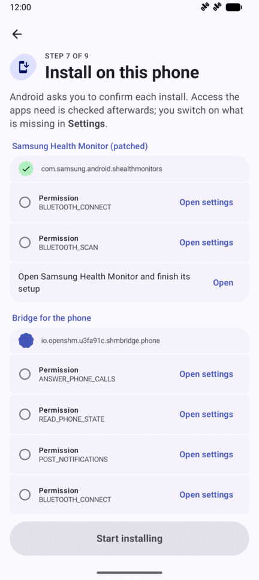
  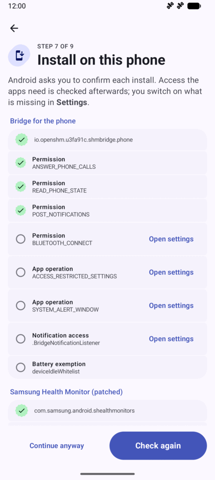
</p>

#### The easy way: let the patcher grant everything (Wireless debugging on this phone)

Some permissions are hard to find in Settings, and on Android 13 or newer some of them are blocked
as *restricted settings*. The patcher can switch them all on for you. To do that, it connects to
**this same phone** through Wireless debugging, a built-in Android developer feature.

This sounds technical, but it is a one-time setup of a few taps. Read the whole list once before
you start, because you will move between the patcher, Settings and the notification panel.

> You need Wi-Fi for this: any network works, even without internet. Mobile data is not enough.
> Nothing here changes your data, and you can turn Wireless debugging and Developer options off
> again when you are done.

**Step A: tap the button in the patcher.** Scroll down to **Grant everything at once** and tap
**Grant everything with Wireless debugging**. The card shows the steps that follow. The patcher
keeps waiting in the background and opens Developer options for you. If they are not on yet, do
step B first.

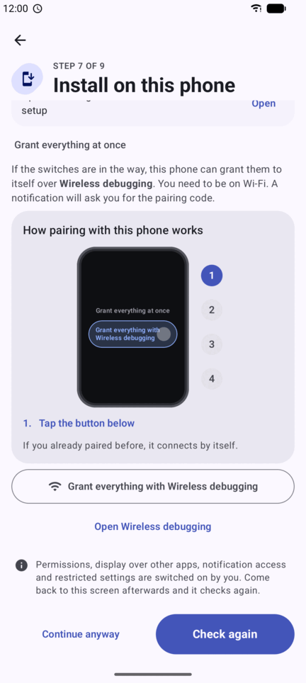

**Step B: turn on Developer options** (only the first time).

1. Open **Settings → About phone**. On some phones it is under *Settings → System → About phone*.
2. Scroll to the bottom and tap **Build number** seven times in a row. On some phones it is inside
   *Software information*.
3. After a few taps Android counts down (*"You are now 1 step away from being a developer"*).
   If you have a screen lock, it asks for your PIN at the end. Then it says *"You are now a
   developer!"*.

<p>
  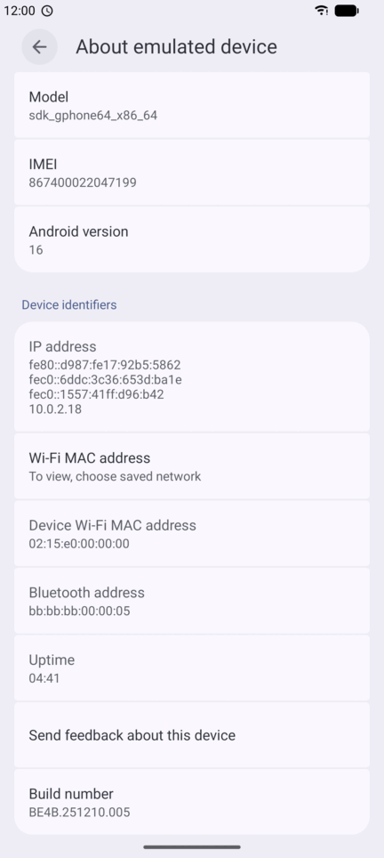
  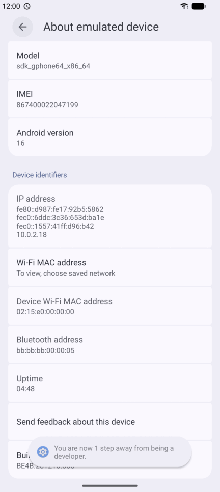
</p>

**Step C: turn on Wireless debugging.**

1. Go to **Settings → System → Developer options**. The patcher normally opens it for you, scrolled
   to the right place.
2. Find **Wireless debugging** in the *Debugging* section and tap its **name**, not only the
   switch, to open its page.
3. Turn on **Use wireless debugging**. Android asks *"Allow wireless debugging on this network?"*:
   tap **Allow**.

<p>
  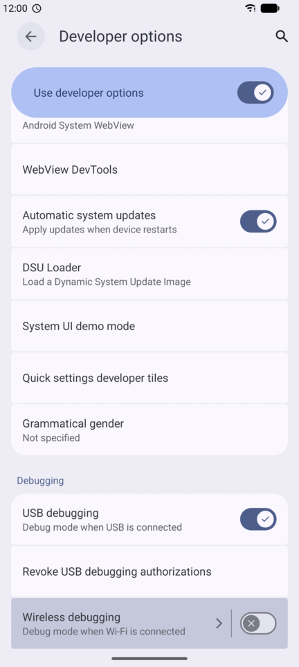
  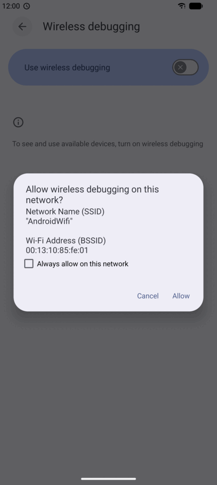
</p>

**Step D: get a pairing code.** On the Wireless debugging page, tap **Pair device with pairing
code**. Android shows a six-digit **Wi-Fi pairing code**. Leave this window open: closing it cancels
the code.

<p>
  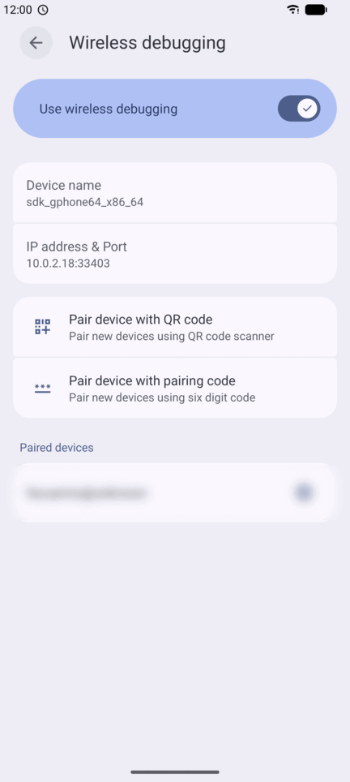
  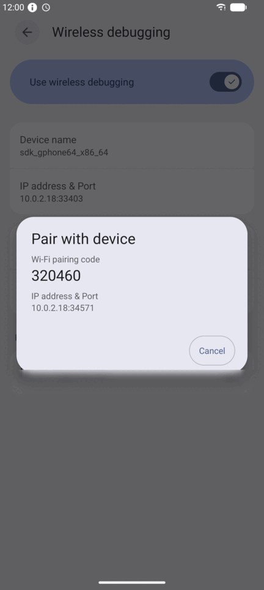
</p>

**Step E: give the code to the patcher.** Without closing the code window:

1. Swipe down from the top of the screen to open the notification panel.
2. Find the LibreWrist notification **Enter the pairing code** and tap **Enter code**.
3. Type the six digits shown on the code window and tap the send arrow.

You can also go back to the patcher and type the code there, but the notification is easier,
because it keeps the code window on screen.

<p>
  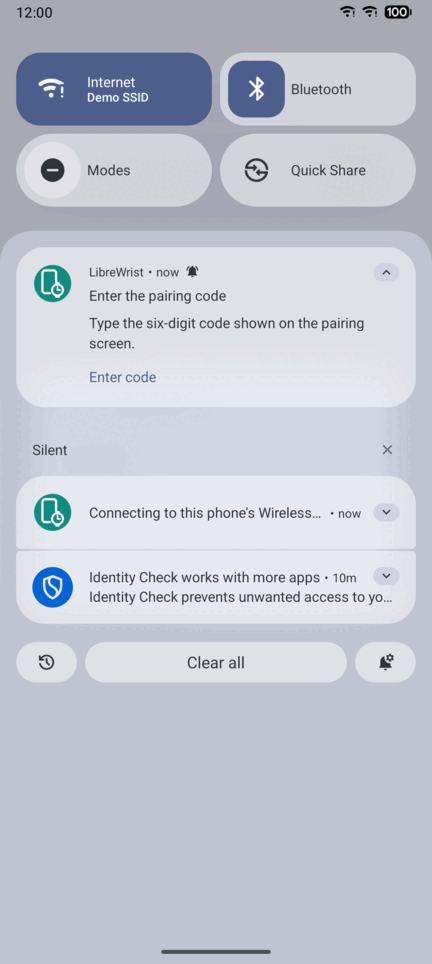
  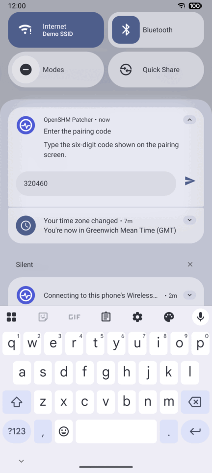
</p>

**Step F: done.** The code window closes by itself. The patcher connects and switches on every
missing permission. Go back to the patcher: it shows **All set** and the permission list turns
green. *LibreWrist* now appears under **Paired devices** in Wireless debugging. The pairing is
remembered, so next time the patcher reconnects without a new code, as long as Wireless debugging is
on.

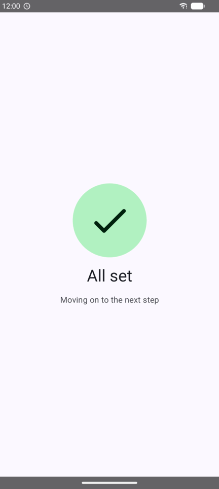

**If something goes wrong:**

- *The notification never asks for a code*: check that Wireless debugging is on and that the phone
  is on Wi-Fi. Also check that notifications are allowed for LibreWrist.
- *"Wrong code"*: codes expire when the window closes. Tap **Pair device with pairing code**
  again and use the new code.
- *Wireless debugging turns itself off*: Android turns it off when you change Wi-Fi networks. Turn
  it on again; you will not need a new code.

### 8. Install on the watch

The watch apps are installed over Wi-Fi, in order: Health Monitor, the bridge, then phone alarms.
Their permissions are granted automatically. Then:

- **Health Platform developer mode**: tap **Turn it on for me** and keep the watch unlocked and
  nearby; or do it by hand, as shown on screen. Without it, the watch will not take ECG
  measurements with the patched app.
- **Earlier copies**: watch bridge and alarm copies left by an earlier package prefix are removed
  first, since they would compete with the current bridge for the link. The phone install step does
  the same with the phone bridge and with Samsung Health+ copies left by an earlier prefix, which
  are duplicates of the current one (Android asks you to confirm each uninstall). The stock Samsung
  Health is never touched.
- **Phone bridge link**: the bridge is registered as a companion app of the phone on the watch, so
  it stays connected without an ongoing notification.
- **Turn off the stock app**: the stock Health Monitor is disabled, not uninstalled, so it does not
  compete with the patched one for the sensor. Apps that are already off are marked as done.

<p>
  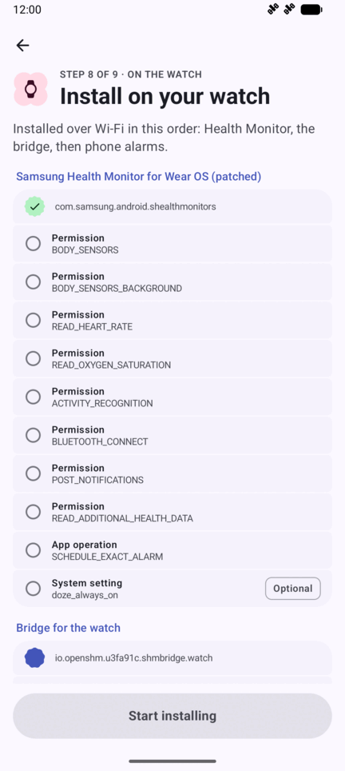
  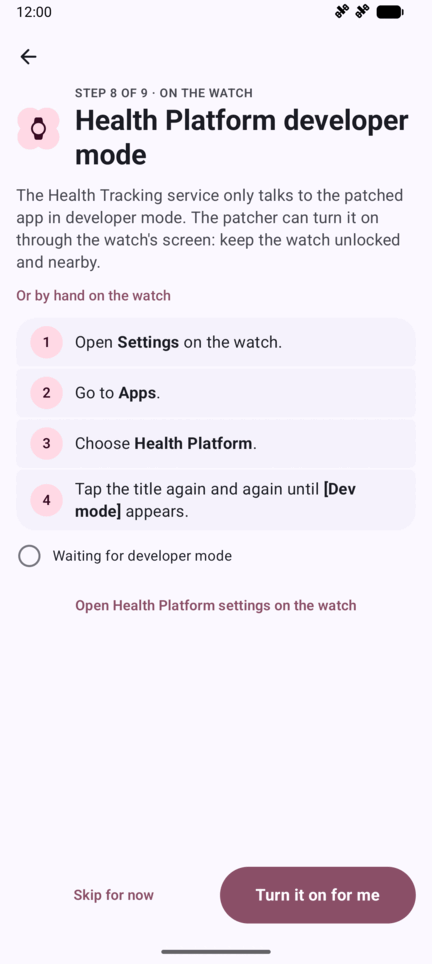
  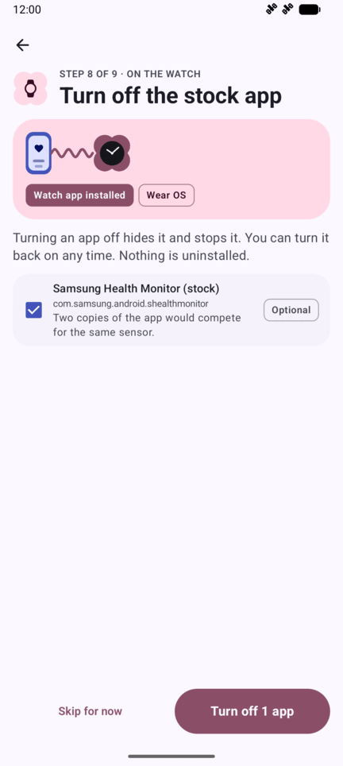
</p>

### 9. Self-test

The patcher runs these checks:

- it confirms what is installed on both devices, with which signature;
- it confirms that permissions are granted;
- it checks that no copy of our apps from an earlier package prefix is left on either device;
- it checks that the bridge link between the phone and the watch is up.

It then asks you a few questions about what you see on the devices. When every check passes, you
are done. **Share report** produces a report with versions and results only, which is useful if
something fails.

<p>
  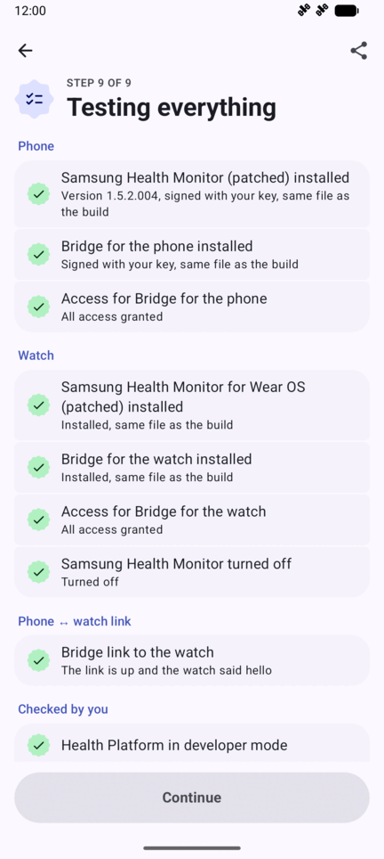
  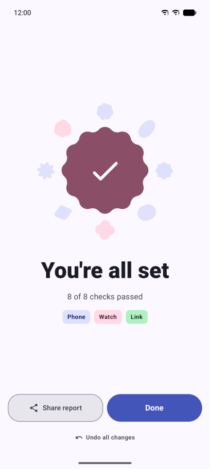
</p>

### 10. Home

From then on, the app opens on **Home**. It shows:

- the state of the last test, with **Test again**;
- the apps you built;
- an update card when a newer catalogue supports newer official apps.

Each app row has two buttons:

- **Rebuild** (*Change patches and rebuild*) opens the patches focused on that app, then runs a
  normal build. Apps that did not change are reused, and the install steps only cover the apps that
  were built again.
- **Restore** removes only that app. For the watch Health Monitor, it also turns the stock app back
  on and resets the watch settings the patcher changed.

**Restore watch** in the Home menu undoes only the watch side. A restored app leaves Home until you
install it again.

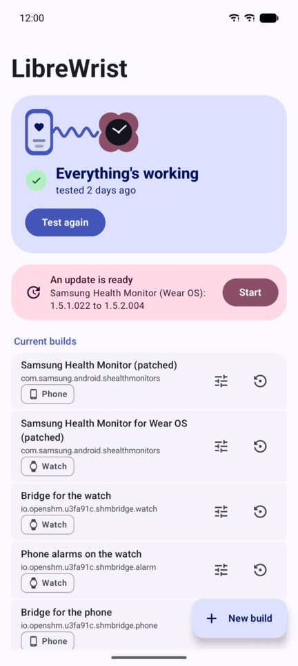

#### Updates of the patcher itself

Release builds of the patcher look for a newer official release on GitHub when they start and about
every 12 hours in the background. When there is one, the app shows an update dialog (and a
notification if the background check found it first); tapping **Update** downloads the APK, checks
its SHA-256 against the release's `SHA256SUMS`, checks that it is this app signed with the same key,
and then asks Android to install it. The app closes while it updates; open it again afterwards. Only
official releases signed with the same key can update the app.

GitHub is asked at most once an hour; in between, the app offers the last build it found each time
it opens. **Later** shows it again on the next opening; ticking **Don't show this version again**
hides that build (dialog and notification) until a newer one comes out. **Check now** always shows it.

To turn this off, open **Settings** (the gear on the first screen, or the Home menu) and switch off
**Check for updates automatically**; that stops both the startup check and the background one.
**Check now** in the same screen still works. Local builds without an update repository never check.

#### Device logs

When a paired watch answers over ADB, Welcome and All set show a **View device logs** link. It
streams logcat from the watch and from the phone (through the phone's own Wireless debugging),
filtered to the patched apps and the system lines that name them. A foreground service keeps
capturing in the background, and **Export** writes both logs into one `.txt` file, handy for bug
reports. Each tab shows whether its device is connected; tap the broken link icon for help, and it
reconnects by itself once the device shows up on the network again.

#### Undo all changes

Welcome, All set and the Home menu offer **Undo all changes**.
It looks for every LibreWrist app on both devices (under the current package prefix and any earlier one
it finds) and only acts on what is actually there:

- on the watch, it removes the bridge's companion association, uninstalls our apps, turns the stock
  Health Monitor back on if it was disabled, and restores `doze_always_on` to 1 if it reads 0;
- on the phone, it uninstalls our apps (Android asks you to confirm each one).

System apps are never touched, and one failing step does not stop the rest. An unreachable watch can
be retried or skipped; the result is then marked as partial. After a complete revert the package
prefix is unlocked and the stored builds are cleared. The last step offers to uninstall LibreWrist
Patcher itself.

### Optional apps

The catalogue declares the apps (`apps` in `catalogue/catalogue.json`, with their texts and icons), so the list
below follows it. On the **Official apps** step each optional app has its own switch, all on by default (opt-out):

- **Samsung Health Monitor** (phone and watch together, one switch);
- **Bridge** (our phone and watch apps that send notifications, calls and alarms to the watch, one switch);
- **Phone alarms on the watch** (on Wear OS 5 and newer, the phone-alarm fork). It needs the Bridge: switching
  the Bridge off switches it off too, and switching it on switches the Bridge on;
- **Samsung Health+** (below).

With Health Monitor off, the Health Platform developer-mode and stock-app steps are
passed over, since they only matter for it.

#### Samsung Health+

The Samsung Health switch adds **Samsung Health** as an extra input. The patcher
builds it as **Samsung Health+**: renamed to `<prefix>.shealth` and signed with your key, so it
installs **next to** the stock Samsung Health from the Play Store instead of replacing it.

- The watch only trusts the Samsung-signed phone app, so the **stock app stays** and keeps syncing
  the watch and uploading to the Samsung cloud.
- Samsung Health+ signs in to the same Samsung account, downloads the history, and unlocks the
  phone-side features hidden on non-Samsung phones (for example the Energy Score tile).
- It reads the sleep apnea status and the BP measurement flag from the patched Health Monitor, so
  the Sleep apnea card shows up under Sleep. This only works because both apps are signed with your
  key.
- Its patches appear on the patches step. Optional ones add a launcher badge (also available for
  SHM) and a local-only mode, which is off by default.

Turn the switch off if you do not want it. On a PC, `scripts/build_shealth.sh` builds the same target.

### What to expect when you are done

- **On the watch**, the patched Samsung Health Monitor replaces the stock one in the app list. It
  offers ECG and blood pressure, including the BP calibration. Irregular heart rhythm notifications
  can be turned on from the phone app.
- **Sleep apnea** is available in every country (its patches are on by default and can be switched
  off together on the patches step). The phone app shows a **Sleep** tab, where the
  apnea setup starts; after that the watch records the blood oxygen level while you sleep. While
  recording, the red and infrared sensor LEDs stay on all night, so expect more battery use.
- **On the phone**, Samsung Health Monitor finds the watch as a compatible device. Readings taken
  on the watch appear there and can be exported as PDF.
- **The bridge** sends phone notifications, incoming calls (answer or decline from the watch) and
  phone alarms to the watch over Bluetooth, with no Samsung phone involved. After installing it, the
  patcher associates the phone with the watch bridge in the watch's Companion Device Manager, so the
  link stays alive (also in Doze and power saving) **without a permanent notification**. Without the
  association it falls back to a foreground service with a "Phone connection" notification, which
  has its own channel so you can hide it without muting alarms or calls.
- **Phone alarms** ringing on the watch can be snoozed or dismissed with a double pinch, if the
  quick action is on in the watch's alarm settings.
- Nothing stock was uninstalled. Galaxy Wearable keeps managing the watch as before.

### How to check that it works

1. **ECG**:
   - On the watch, open Samsung Health Monitor, choose **ECG**, rest your arm on a table and hold a
     fingertip on the top button for 30 seconds.
   - The watch shows a result (for example *Sinus rhythm*). Within a minute, the same reading shows
     up in Samsung Health Monitor on the phone.
2. **Blood pressure**:
   - In the phone app, start a calibration with a cuff monitor, taking three readings. The watch
     completes the calibration.
   - After that, measure from the watch. The result syncs to the phone the same way as ECG.
3. **Sleep apnea**:
   - In the phone app, open the **Sleep** tab and finish the sleep apnea setup.
   - Sleep with the watch on. Nights shorter than 1 hour are ignored, and a result needs about 3
     hours. After you wake up, the result shows up in the phone app.
4. **Bridge**:
   - Send yourself a message, or call the phone: the notification or the call shows on the watch.
   - Set an alarm on the phone a couple of minutes ahead: it rings on the watch. With the watch on
     your wrist, a double pinch snoozes or dismisses it.
5. **If something does not arrive**, run **Test again** from Home and share the report. Most
   problems are one of these:
   - Health Platform developer mode turned off on the watch;
   - a missing permission;
   - the watch disconnected from Galaxy Wearable.

[↑ Back to contents](#contents)

## Known issues

These come from user reports. Each one links to its GitHub issue, where progress is tracked.

:mag: under investigation · :construction: fix in progress · :hourglass_flowing_sand: fix released, waiting for user confirmation

If you are affected, a device log helps most: turn on wireless debugging on the phone and the
watch, open the patcher, tap **View device logs** at the bottom of the welcome screen, reproduce
the problem and tap **Export .txt**. Attach the file to the issue.

- :construction: **Samsung Health+ is very slow to get new data, and some of it can go missing** ([#9](https://github.com/LibreStatic/LibreWrist/issues/9))
  - **Cause:** Samsung Health+ has no direct link to the watch. The stock Samsung Health uploads the watch data to the Samsung cloud, and Samsung Health+ downloads it from there. That round trip can take more than a day, and a sync that stops halfway or clashes with data Samsung Health+ already has loses part of the data.
  - **Status:** confirmed. A more reliable sync is in progress.
  - **Workaround:** the stock Samsung Health app has the up-to-date data. Samsung Health Monitor (ECG, blood pressure, IHRN, sleep apnea) is not affected, because it syncs straight from the watch.
- :mag: **Several smaller Samsung Health Monitor problems on the watch** ([#13](https://github.com/LibreStatic/LibreWrist/issues/13))
  - :hourglass_flowing_sand: **Sleep apnea tracking drains the battery, and the sensor light stays on after waking up.** Since 0.10.4 the overnight recording held the watch awake, and 0.10.9 and 0.10.10 renewed that hold for every sensor sample (about three times the battery use). Health Monitor also did not always tell the recording to end. 0.10.11 no longer holds the watch awake while the sensor sends data, and 0.10.12 ends the recording when Health Monitor reads the night's data (or after 12 hours, or 10 minutes without a sleep session). Rebuild and install the watch Health Monitor with 0.10.12. An affected user still needs to report that the battery is back to normal and that nights still count.
  - :hourglass_flowing_sand: **A daily "Health Monitor" notification on the watch that cannot be dismissed.** The sleep apnea service posted it. Since 0.10.4 it shows no notification when the patcher granted the battery optimization exemption, and a low-importance "Sleep apnea" one otherwise. An affected user still needs to report that it is gone.
  - :mag: **ECG readings sometimes fail.** A single brief loss of finger contact cancelled the reading; 0.10.0 ignores such short blips, but the reporter still sees occasional failures. A device log of a failed reading helps.
  - :mag: **The heart rate shown during an ECG jumps a lot.** Since 0.10.0 the device log records the beat timing during an ECG, so the jumps can be traced. A dirty, wet or scratched sensor can also cause this.
- :hourglass_flowing_sand: **IHRN never measures on some watches** ([#26](https://github.com/LibreStatic/LibreWrist/issues/26))
  - **Cause:** IHRN only schedules its measurements after it sees that the watch is on the wrist. It asked for that through a Samsung-only off-body sensor that the watch refuses to a re-signed Health Monitor, so it never saw the watch being worn and never measured. Confirmed from the reporter's device log on a Galaxy Watch Ultra 2.
  - **Status:** 0.10.14 uses the standard Android off-body sensor instead (the blood pressure check uses it too). Rebuild and install the watch Health Monitor with 0.10.14. An affected user still needs to report that IHRN measures again.
  - **Note:** IHRN only keeps a history when it finds an irregular rhythm, so an empty history after the fix can be normal.
- :mag: **Some sleep apnea nights are not counted** ([#26](https://github.com/LibreStatic/LibreWrist/issues/26))
  - **Cause, first night:** the Health Tracking service on the watch refused the recording all night, which happens when Health Platform developer mode is off. The recording then retried every 15 seconds without success. Since 0.10.14 it waits longer between retries and writes the cause once in the device log.
  - **Cause, second night:** the recording stopped after midnight without a trace (the app was closed, or the watch shut down). Since 0.10.14 the device log records how the app was last closed and the battery level every 15 minutes, so a log from such a night shows the cause.
  - **Workaround:** keep Health Platform developer mode on (see the setup steps) and charge the watch before sleeping.
- :construction: **Sleep apnea recording drains the battery on a Galaxy Watch8** ([#27](https://github.com/LibreStatic/LibreWrist/issues/27))
  - **Status:** reported on a Galaxy Watch8 40 mm with 0.10.12. While recording it draws about 55 to 80 mA, against about 26 mA above idle measured on a Galaxy Watch5 Pro, so the watch runs flat before morning. Confirmed. A fix is in progress: a way to record without holding the watch awake is being tested.
  - **Workaround:** turn sleep apnea screening off on that watch until it is fixed.

[↑ Back to contents](#contents)

## How it works

1. The watch is paired with the phone through the stock Galaxy Wearable flow, which creates the GMS
   Data Layer between them.
2. Both patched SHM apps share one package (`com.samsung.android.shealthmonitors`) and one signing
   certificate. GMS needs both to deliver messages between the two apps.
3. On the watch, our ECG, BP and SpO2 adapters stand in for the privileged sensors. They talk to
   the Health Tracking service through a clean-room client
   ([protocol](docs/health-tracking-protocol.md)), which the service only accepts while Health
   Platform developer mode is on.
4. The bridge talks to the watch directly over RFCOMM, phone ⇄ watch.

Everything runs on the two devices. Details are in [docs/architecture.md](docs/architecture.md).

[↑ Back to contents](#contents)

## Repository layout

| Path | What it is |
|---|---|
| `patcher-app/` | The LibreWrist Android app, a Gradle build with three modules: `:engine` (pure JVM patch engine), `:adb` (ADB client) and `:app` (Compose UI). Third-party licences are in [patcher-app/THIRD_PARTY.md](patcher-app/THIRD_PARTY.md). |
| `catalogue/` | The signed patch catalogue. `catalogue.json` describes the inputs, profiles and patterns as data; `catalogue.json.sig` and `catalogue.pub` are its signature and public key. Details in [docs/patches.md](docs/patches.md). |
| `superpatcher/`, `scripts/superpatcher.py` | The Python patch engine. It interprets the same catalogue as the app. |
| `watch-mod/` | Our own code injected into the watch SHM: the ECG, BP and SpO2 adapters, the Health Tracking client and the vendor overrides. |
| `shm-bridge/` | Our own bridge apps (phone ⇄ watch over direct RFCOMM) and the fork of the watch Alarm app. |
| `scripts/` | The PC build (`build_all.sh`, `build_shm_*.sh`, `build_shealth.sh`, `fetch_deps.sh`), catalogue tooling (`catalogue.py`), and shared helpers in `scripts/lib/`. |
| `apks/` | Where the official input APKs go for PC builds. They are not versioned; see [apks/README.md](apks/README.md) and `apks/inputs.json`. |
| `docs/` | [Architecture](docs/architecture.md), [installation runbook](docs/installation.md), [patches](docs/patches.md), [Health Tracking client](docs/health-sdk.md) and [protocol](docs/health-tracking-protocol.md), [SpO2 adapter](docs/spo2-adapter.md), the sensor datasheets ([ECG](docs/ecg-calibration.md), [BP calibration](docs/bp-calibration.md), [SpO2](docs/spo2-calibration.md)), plus research notes on Samsung Health ([phone survey](docs/samsung-health-survey.md), [watch survey](docs/shealth-watch-survey.md)). |

[↑ Back to contents](#contents)

## Building on a PC

The original shell pipeline is still available, and it produces the same five APKs:

```bash
scripts/fetch_deps.sh                 # apktool into third_party/
# copy the official APKs into apks/ with the names listed in apks/SHA256SUMS
PKG_PREFIX=com.example scripts/build_all.sh
```

All configuration lives in [`config.env`](config.env) and can be overridden through environment
variables: package prefix, SDK, keystore and directories. Our source code uses the package
placeholder `shminterop`, and builds rewrite it to the chosen `PKG_PREFIX`. Manual installation with
ADB, pairing, and known gotchas are covered in [docs/installation.md](docs/installation.md).

### Building the patcher app

The launcher `patcher-app/gradlew` is a jar-free script, since the repository carries no jars. Run
it with a JDK 17 and the Android SDK:

```bash
JAVA_HOME=/path/to/jdk17 patcher-app/gradlew :engine:test :app:testDebugUnitTest :app:assembleDebug
```

Builds are signed with `patcher.p12` and `patcher.pass` from `OPENSHM_KEYS_DIR` (key alias
`PATCHER_KEY_ALIAS`, default `patcher`). Without them, builds fall back to the SDK debug key. The
published releases are built by `.github/workflows/patcher-release.yml` and signed with the
LibreStatic release key.

[↑ Back to contents](#contents)

## Tests

```bash
python3 -m unittest discover -s superpatcher -p 'test_*.py'
python3 -m unittest discover -s scripts -p 'test_*.py'
shm-bridge/watch/test/run-tests.sh
watch-mod/test/run-tests.sh
JAVA_HOME=/path/to/jdk17 patcher-app/gradlew :engine:test :app:testDebugUnitTest
```

[↑ Back to contents](#contents)

## Scope

Dropped on purpose:

- the PC relay or gateway, replaced by native GMS and direct RFCOMM;
- the Galaxy Wearable proxy, which never worked.

Never needed:

- a factory reset;
- a Samsung phone.

[↑ Back to contents](#contents)

## Licence

Our own code is released under the [MIT Licence](LICENSE). The MIT licence does not cover:

- Samsung's apps and the APKs built from them, which remain under their owners' terms;
- the third-party libraries shipped in the patcher app, which keep their own licences (see
  [patcher-app/THIRD_PARTY.md](patcher-app/THIRD_PARTY.md)).

This is an independent project. It is not affiliated with Samsung or Google.

[↑ Back to contents](#contents)
